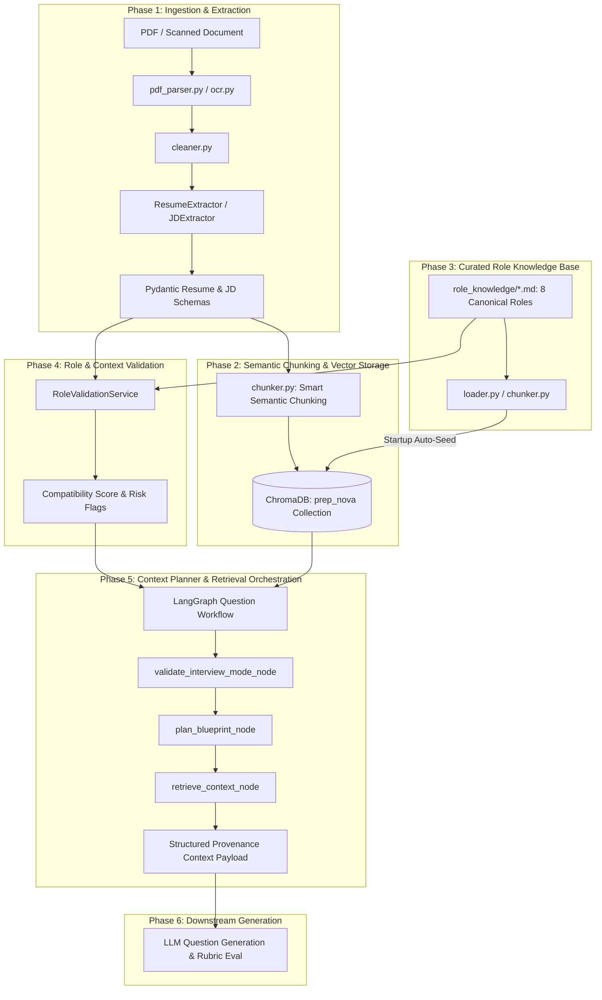

# PrepNova — RAG Context & Planning Pipeline Architecture (Phases 1–5)

This document provides a comprehensive technical guide for developers on how the **PrepNova Context & Planning Pipeline** works from initial document ingestion up to the **Context Planner**, immediately before LLM interview question generation.

---

## 1. High-Level Architecture Overview



---

## 2. Phase 1: Ingestion & Document Extraction

**Location:** `app/services/extraction/`

### 1. File Ingestion & OCR Fallback
- **PDF Extraction (`pdf_parser.py`):** Uses PyPDF to parse uploaded PDF documents. If extracted character count is below 100 characters (indicating a scanned or image-based document), it automatically triggers OCR fallback.
- **OCR Fallback (`ocr.py`):** Employs `pdf2image` and `pytesseract` to perform optical character recognition.
- **Normalization (`cleaner.py`):** Cleans Unicode artifacts, strips non-printable control characters, and standardizes whitespace while preserving programming syntax (e.g. `C++`, `C#`, `.NET`, `REST-API`).

### 2. Dual-Engine Structured LLM Extraction
- **Resume Extractor (`resume_extractor.py`)** & **JD Extractor (`jd_extractor.py`):**
  - **Primary Execution:** Invokes Gemini using LangChain's native `.with_structured_output(Schema)` for schema-enforced JSON.
  - **Resilient Fallback:** If native structured mode encounters unformatted responses, regex-based markdown fence stripping (`re.sub(r"^```json...")`) cleans the content and parses it through `PydanticOutputParser` and `json.loads()`.
  - **Resulting Schemas:** Strictly typed Pydantic models: `Resume` and `JobDescription` located in `app/schemas/`.

---

## 3. Phase 2: Processing, Semantic Chunking & Vector Storage

**Location:** `app/services/processing/` & `app/services/vectorstore/`

### 1. Noise-Free Semantic Chunking (`chunker.py`)
Earlier naive chunking strategies vectorized candidate contact details and generated dozens of fragmented education chunks that flooded similarity search. The optimized chunking strategy enforces:
- **Exclusion of Pure PII:** Candidate phone numbers, personal emails, and home addresses are kept in document metadata and **excluded from vector search chunks** so they never consume similarity slots.
- **Consolidated Education:** All degree and university entries are aggregated into a single structured education chunk (`section="education"`).
- **Independent Experience & Project Chunks:** Work experience roles and portfolio projects are chunked individually with metadata tags:
  - `section`: `"experience"` | `"project"` | `"skills"` | `"certifications"`
  - `source`: `"resume"` or `"jd"`

### 2. Multi-Tenant ChromaDB Scoping (`chroma_store.py`)
All embeddings use Google’s `text-embedding-004` (768 dimensions) stored in a persistent ChromaDB instance (`data/chroma/chroma.sqlite3`).
- **User Scope (`scope="user"`):** Candidate resumes and job descriptions are indexed with `{"scope": "user", "user_id": <id>, "document_id": <id>}`. Strict `$and` filtering guarantees zero data leakage between candidates.
- **Global Scope (`scope="global"`):** Curated role knowledge documents are tagged with `{"scope": "global", "document_type": "role", "role": <role_name>}` and shared across all sessions.

---

## 4. Phase 3: Curated Role Knowledge Base

**Location:** `app/services/role_knowledge/` & `role_knowledge/`

### 1. Canonical Role Coverage
PrepNova provides curated, production-grade technical interview standards across **8 major engineering roles**:
1. `ai_engineer`: Agents, Python LLM ecosystems, RAG architecture, vector search.
2. `backend_engineer`: REST/GraphQL API design, database transactions & indexing, system design.
3. `frontend_engineer`: Component architecture, state management (Zustand/RTK/Context), Core Web Vitals & rendering.
4. `fullstack_engineer`: Client-server integration, monorepos, database schemas, OWASP security, JWT/OAuth.
5. `devops_engineer`: Docker/OCI cgroups, Kubernetes orchestration, CI/CD GitOps, observability & SRE.
6. `data_scientist`: ML algorithms, feature stores, SQL window functions, classification/regression metrics.
7. `cloud_engineer`: Multi-AZ VPC networking, IAM least-privilege, serverless Lambda/SQS, FinOps.
8. `qa_engineer`: Test automation pyramid (Playwright/Cypress), API load testing (k6), BDD shift-left.

### 2. Automatic Startup Seeding (`seed.py`)
On FastAPI startup (`main.py`), `seed_role_knowledge(force=False)` automatically checks ChromaDB. If any of the 8 canonical roles have 0 indexed chunks, it reads the markdown files, runs `RoleKnowledgeChunker` (splitting by markdown headings), and upserts them into ChromaDB under `scope="global"`.

### 3. Role Alias Resolution
The retriever normalizes UI/client labels automatically:
- `"Frontend Developer"`, `"React Developer"`, `"UI Engineer"` $\rightarrow$ queries `"Frontend Engineer"`.
- `"Backend Developer"`, `"Node Developer"`, `"API Engineer"` $\rightarrow$ queries `"Backend Engineer"`.
- `"Cloud Architect"`, `"AWS Specialist"` $\rightarrow$ queries `"Cloud Engineer"`.

---

## 5. Phase 4: Role & Context Validation

**Location:** `app/services/role_validation/` & `app/schemas/role_validation.py`

Before generating questions, `RoleValidationService` validates the alignment between the Candidate's Resume, Target Role, and Job Description.

### Key Outputs of Validation:
- **`compatibility_score` (0.0 to 100.0):** Weighted match ratio considering required skills, experience overlap, and canonical prerequisites.
- **`prerequisites`:** Itemized evaluation of foundational competencies (marked `met`, `partial`, or `missing`).
- **`risk_flags`:**
  - `MAJOR_DOMAIN_MISMATCH`: High-severity flag raised when candidate experience has near-zero overlap with target role (e.g. Graphic Designer applying for SRE).
  - `JD_CORE_SKILLS_MISSING`: Medium-severity flag when resume lacks required JD technologies.
- **`recommended_adjustments`:** Dynamic advice fed into blueprint planning (e.g. calibrate questions to foundational principles before introducing distributed architecture).

---

## 6. Phase 5: Context Planning & Retrieval Orchestration

**Location:** `app/services/interview/graph.py`

Context planning is executed via a LangGraph state machine (`question_workflow`):

### 1. Six Supported Interview Modes
The workflow deterministically enforces source permissions based on `validated_mode`:
| Mode | Allowed Sources | Applied Metadata Filter |
| :--- | :--- | :--- |
| `ROLE` | Global Role KB only | `{"$and": [{"scope": "global"}, {"document_type": "role"}, {"role": role}]}` |
| `RESUME` | Candidate Resume only | `{"$and": [{"scope": "user"}, {"user_id": uid}, {"document_id": resume_id}]}` |
| `JD` | Target Job Description only | `{"$and": [{"scope": "user"}, {"user_id": uid}, {"document_id": jd_id}]}` |
| `RESUME_ROLE` | Candidate Resume + Role KB | Dual query: user resume + global role filter |
| `RESUME_JD` | Candidate Resume + Job Description | Dual query: user resume + user JD filter |
| `RESUME_JD_ROLE` | Resume + JD + Role Knowledge | Triple query: user resume + user JD + global role filter |

### 2. Context Retrieval with Section Provenance
Inside `retrieve_context_node`, chunks are retrieved with section metadata preserved and assembled into structured evidence blocks:

```markdown
=== [Candidate Resume Experience - What candidate has done] ===
- [EXPERIENCE] Company: Acme Corp | Role: Senior Engineer | Responsibilities: Built FastAPI microservices and distributed queues.
- [PROJECT] Project: PrepNova | Description: AI Mock interview platform using ChromaDB and LangGraph.

=== [Target Job Description Requirements - What employer expects] ===
- [REQUIREMENTS] Required: 3+ years experience with high-throughput distributed systems and PostgreSQL.

=== [Standard Industry Best Practices for Backend Engineer] ===
- [DATABASES] ACID transactions, transaction isolation levels (Read Committed, Serializable), and indexing strategies.
```

### 3. Graceful Fallbacks
- If an unseeded role is queried, the retriever provides structured foundational role standards rather than failing silently with an empty string.
- If a candidate resume lacks details on a specific slot topic, the blueprint adapts to probe theoretical knowledge without hallucinating nonexistent candidate experience.


### 4. Difficulty Calibration & Interview Benchmark Matrix (`benchmark.py`)
To prevent repeated questions and ensure a realistic, well-rounded technical interview, PrepNova introduces the **6-Turn Interview Benchmark Matrix**:

| Turn | Question Category | Beginner / Junior Focus | Mid-Level Professional Focus | Senior / Staff Engineer Focus |
| :--- | :--- | :--- | :--- | :--- |
| **Turn 1** | **Core Concept & Syntax** | Language primitives, value vs reference, basic operators, HTTP verbs, simple SQL queries. | Framework rendering engine, async event loop microtasks, indexing structures (B-Tree). | Low-level memory layouts, GC pause tuning, lock contention, thread safety under high concurrency. |
| **Turn 2** | **Coding / Implementation** | Direct coding: filtering arrays, basic form validation, input handling. | Performance optimization: debouncing, memoization, EXPLAIN ANALYZE, Redis caching. | Distributed systems: sharding keys, Kafka partition lag, distributed rate limiting. |
| **Turn 3** | **Debugging & Error Handling** | Common bugs: `undefined.map()`, CORS errors, 500 error log inspection. | Subtle production incidents: race conditions, N+1 queries, memory leak profiling. | Cascading failures: cache stampede / thundering herd, circuit breakers, split-brain mitigation. |
| **Turn 4** | **Design & Architecture** | Component breakdown, props vs local state, folder structure (No distributed systems!). | Subsystem design: pre-signed cloud uploads, idempotent payment contracts, accessible UI tables. | End-to-end system design: real-time collaborative doc editing, global notification service. |
| **Turn 5** | **Data & Security** | Data persistence: localStorage vs cookies, preventing SQL injection via prepared statements. | Auth architecture: JWT rotation with refresh tokens, PKCE, ACID transaction isolation. | Distributed transactions: Saga pattern vs 2PC, transactional outbox, CQRS, zero-trust mTLS. |
| **Turn 6** | **Experience & Trade-offs** | Project walkthrough, overcoming personal coding bugs, learning new tools. | Engineering trade-offs: why tech X over Y, refactoring legacy code under live traffic. | Production war stories: post-mortem of severe outages, leading zero-downtime DB migrations. |

- **Strict Difficulty Constraints:**
  - **Beginner:** Strictly forbidden from asking microservices, distributed systems, CAP theorem, or architectural trade-offs.
  - **Advanced:** Strictly forbidden from asking surface-level syntax trivia (e.g. "what is a variable").
- **Strict Duplicate Rejection:** Cosine similarity threshold tightened to `0.78` and Jaccard token threshold to `0.60`. Any candidate question matching an earlier turn is rejected on all attempts and replaced with a calibrated fallback question.
- **Calibrated Fallbacks:** Fallback questions specifically match the difficulty and turn type rather than generic architecture prompts.

---

## 7. Developer Quick Reference

### Running the Full Pipeline Test Suite
From `AIService/`:
```bash
.\.venv\Scripts\python.exe scripts\test_rag_context_pipeline.py
.\.venv\Scripts\python.exe scripts\test_benchmark_matrix.py
.\.venv\Scripts\python.exe scripts\test_question_generation_pipeline.py
```
This verifies:
1. All 8 canonical roles are loaded from disk and indexed in ChromaDB.
2. Candidate contact noise is filtered and education is consolidated.
3. Role validation detects skill overlap, prerequisites, and flags domain mismatches.
4. LangGraph retrieves context with proper provenance demarcation headers.
5. All 6 question categories rotate deterministically per the difficulty benchmark.
6. Semantic and exact duplicate rejection stops repeated questions across all turns.

### Testing Role Seeding Manually
```bash
.\.venv\Scripts\python.exe -c "from app.services.role_knowledge.seed import seed_role_knowledge; print(seed_role_knowledge(force=True))"
```

### API Endpoints
- `POST /interview/generate-question`: Generates an adaptive, benchmark-grounded question through LangGraph.
- `POST /interview/validate-context`: Pre-validates candidate profile compatibility against role and JD.
- `POST /interview/evaluate-answer`: Evaluates candidate answer across the 5-point rubric.
- `POST /interview/evaluate-session`: Holistic batch session evaluation scorecard.
