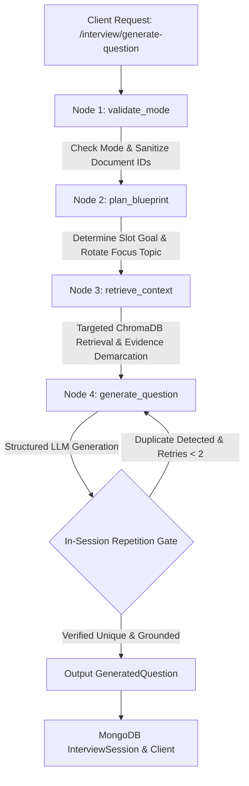

# PrepNova Question Generation Architecture & Pipeline

## 1. Overview & Architecture

PrepNova features a deterministic, context-grounded, and adaptive question generation pipeline orchestrated through **LangGraph** within the Python FastAPI `AIService`. 

The pipeline ensures that:
1. **Source Policy is strictly enforced**: The user's chosen interview configuration (Resume, Role, Job Description, or combinations thereof) deterministically governs what documents can be retrieved. Unselected or old documents from past sessions cannot pollute context.
2. **Repetition is programmatically prevented**: The pipeline uses both exact token Jaccard similarity and semantic embedding cosine similarity (via `BAAI/bge-small-en-v1.5`) to detect and reject duplicate or rephrased questions before they reach the candidate.
3. **Turn Progression is planned**: A lightweight blueprint assigns specific competency goals and target topics to each turn, preventing consecutive questions on the exact same topic.
4. **Candidate Experience is separated from Job Requirements**: The prompt strictly demarcates what the candidate has achieved on their resume versus what the employer expects in the job description, stopping hallucinated candidate skills.
5. **Skipped Questions preserve full context**: Skipping a question steps down difficulty while maintaining the active resume/JD/role context, rather than dropping to a static, ungrounded question bank.

---

## 2. End-to-End Pipeline Execution Flow



### Execution Steps:
1. **Request Intake**: `api/routes/interview.py` receives `GenerateQuestionRequest` containing `user_id`, `role`, `difficulty`, `mode`, `resume_id`, `jd_id`, `history`, and `focus_areas`.
2. **Node 1: `validate_mode`**: 
   - Validates the requested mode against available inputs.
   - Zeros out unpermitted source IDs (e.g. if `mode="role"`, `resume_id` and `jd_id` are explicitly set to `None`).
3. **Node 2: `plan_blueprint`**:
   - Calculates `turn_index = len(history) + 1`.
   - Selects the active slot objective (Architecture -> Mechanics -> Debugging -> Optimization -> Scalability).
   - Rotates deterministically across candidate's `focus_areas`.
   - Assembles the targeted retrieval query: `{active_focus_topic} {slot_objective}`.
4. **Node 3: `retrieve_context`**:
   - Executes targeted queries against ChromaDB only for authorized sources.
   - Demarcates retrieved evidence into:
     - `=== [Candidate Resume Experience - What candidate has done] ===`
     - `=== [Target Job Description Requirements - What employer expects] ===`
     - `=== [Standard Industry Best Practices for {role}] ===`
5. **Node 4: `generate_question`**:
   - Builds strict non-repetition instructions and lists all previously asked questions in the session.
   - Calls Groq LLM (`openai/gpt-oss-120b`).
   - Runs **Deterministic Repetition & Duplicate Check**:
     - Token-set Jaccard overlap check (> 0.65 flags near-exact rephrasing).
     - Cosine similarity check using `BAAI/bge-small-en-v1.5` embeddings (>= 0.82 flags semantic duplicates).
   - If a duplicate is detected and attempt count < 2, retries with an altered perspective.
   - Returns a structured `GeneratedQuestion` payload with `question`, `category`, `format`, `focus_topic`, `intent`, and `expected_concepts`.

---

## 3. Supported Context Modes & Source Policies

PrepNova supports 7 context combinations:

| Mode ID | Display Name | Permitted Sources | Excluded Sources | Required Inputs |
| :--- | :--- | :--- | :--- | :--- |
| `resume` | Resume Only | User's active Resume (`resume_id`) | Job Description, Role Knowledge | `resume_id`, `user_id` |
| `role` | Role Only | Global Role Knowledge Base | Resume, Job Description | `role` |
| `resume_jd` | Resume + JD | User Resume + Job Description | Global Role Knowledge Base | `resume_id`, `jd_id`, `user_id` |
| `resume_role` | Resume + Role | User Resume + Global Role Knowledge | Job Description | `resume_id`, `role`, `user_id` |
| `role_jd` | Role + JD | Global Role Knowledge + Job Description | Resume | `role`, `jd_id`, `user_id` |
| `resume_jd_role`| Complete Context | Resume + Job Description + Role Knowledge | None | `resume_id`, `jd_id`, `role`, `user_id` |
| `jd` | JD Only | Job Description (`jd_id`) | Resume, Global Role Knowledge | `jd_id`, `user_id` |

### Deterministic Source Isolation Guarantee:
In `validate_interview_mode_node` (`app/services/interview/graph.py`), unpermitted IDs are forcefully sanitized:
```python
if requested_mode == InterviewMode.ROLE.value:
    effective_resume_id = None
    effective_jd_id = None
    effective_role = raw_role
```
Even if a frontend client sends an old `resume_id` stored in `localStorage`, the engine discards it when in `role` or `jd` modes.

---

## 4. Lightweight Blueprint & Slot Planning

Rather than querying all skills simultaneously on every turn, the blueprint rotates dynamically across both **Difficulty-Calibrated Rubrics** and **Role-Specific Topic Trees**:

### Difficulty Calibration Matrix (Beginner vs Intermediate vs Advanced):
- **Beginner / Junior Level**:
  - Focus: Core language mechanics, fundamental syntax, basic functional coding, runtime error diagnostics, small component structure, and basic security/data validation.
  - Hard Rule: **Zero** distributed systems, microservices, CAP theorem, or complex architectural trade-offs.
- **Intermediate / Mid-Level**:
  - Focus: Practical production implementation, framework internals (virtual DOM, indexing, async event loop), subtle race conditions, error resilience, and engineering trade-offs.
- **Advanced / Senior Level**:
  - Focus: High-throughput distributed systems, low-level concurrency/memory allocation internals, cascading failure recovery, complex system design, and architectural leadership.

### Turn Progression Matrix:
- **Turn 1**: Core Syntax, Primitives & Language Mechanics (Beginner) / Lifecycle & Internals (Intermediate) / Concurrency & Runtime Internals (Advanced)
- **Turn 2**: Hands-on Implementation / Coding Logic
- **Turn 3**: Debugging & Error Handling / Root Cause Analysis
- **Turn 4**: Component Structure & Modular Design / Service Design
- **Turn 5**: Data Basics, Input Validation & Security
- **Turn 6**: Project Experience, Implementation Hurdles & Engineering Trade-offs

### Focus Topic Rotation:
When the candidate selects focus skills (e.g. `["React.js", "TypeScript", "State Management"]`) or platform defaults for the role (e.g. `["JavaScript Core", "React Component Lifecycle", "DOM Performance", ...]`), the active topic is chosen by:
```python
active_focus_topic = role_topics[(turn_idx - 1) % len(role_topics)].strip()
```
This guarantees distinct topic coverage across turns without repeating the same technical area.

---

## 5. Originality & Dynamic Fallback Guarantee

1. **Strict LLM Originality Rule**: Reference questions are provided strictly as style benchmarks, never as questions to parrot. The prompt explicitly prohibits verbatim copying and demands an original question centered on `{focus_topic}` and `{role}`.
2. **Dynamic Topic-Grounded Fallback**: If the external LLM is ever unreachable or times out, the system never returns static, hardcoded example questions. Instead, `get_calibrated_fallback_question` generates a dynamic, topic-specific question strictly grounded in the candidate's active `{focus_topic}`, `{role}`, and `{difficulty}` tier.

---

## 6. Verification & Test Suite

The pipeline is verified by automated test suites in `AIService/scripts/`:
- `test_benchmark_matrix.py`: Verifies benchmark matrix slots, 8 role topic trees, difficulty differentiation, and duplicate rejection.
- `test_question_generation_pipeline.py`: 18/18 end-to-end checks covering source isolation, blueprint rotation, semantic duplication detection, and LangGraph execution.
- `test_rag_context_pipeline.py`: Context preparation and ChromaDB retrieval verification.

---

## 5. Repetition Detection Engine

The repetition engine enforces non-repetition within the session:

### A. Normalized Token Jaccard Check
Strips stopwords, punctuation, and lowercase text. If token overlap between the candidate question and any previous question exceeds `0.65`, it is flagged as a near-exact rephrase.

### B. Embedding Cosine Similarity Check
Reuses the in-memory singleton `BAAI/bge-small-en-v1.5` (`EmbeddingService`).
- Embeds candidate question in < 5ms on CPU.
- Computes cosine similarity against all previous turns in `state.history`.
- If cosine similarity >= `0.82`, it is flagged as a semantic duplicate.

```python
sim = compute_cosine_similarity(candidate_emb, prev_emb)
if sim >= 0.82:
    # Trigger in-graph retry with alternate angle
```

### C. Bounded Retry
The generator attempts up to 2 LLM invocations with alternate perspective prompting before falling back to a slot-grounded distinct template. Rejected candidates are never saved to session history.

---

## 6. Verification & Automated Test Suite

To verify the question generation pipeline:

```bash
cd AIService
.venv/Scripts/python scripts/test_question_generation_pipeline.py
```

### Test Coverage Summary:
- **Suite 1: Source Policy & Mode Enforcement**: Validates that all 7 context modes strictly isolate their allowed sources and reject unpermitted document IDs.
- **Suite 2: Blueprint Planning & Slot Rotation**: Verifies slot objective progression and focus topic rotation across turns 1–3.
- **Suite 3: In-Session Duplicate Detection**: Validates exact matches, high-overlap rephrasings, and semantic duplicates (cosine similarity) are caught while distinct questions pass.
- **Suite 4: End-to-End Workflow Invocation**: Validates LangGraph graph execution, output schema compliance, and metadata preservation.
