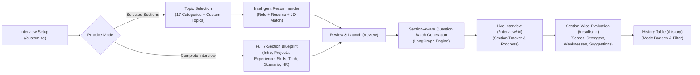
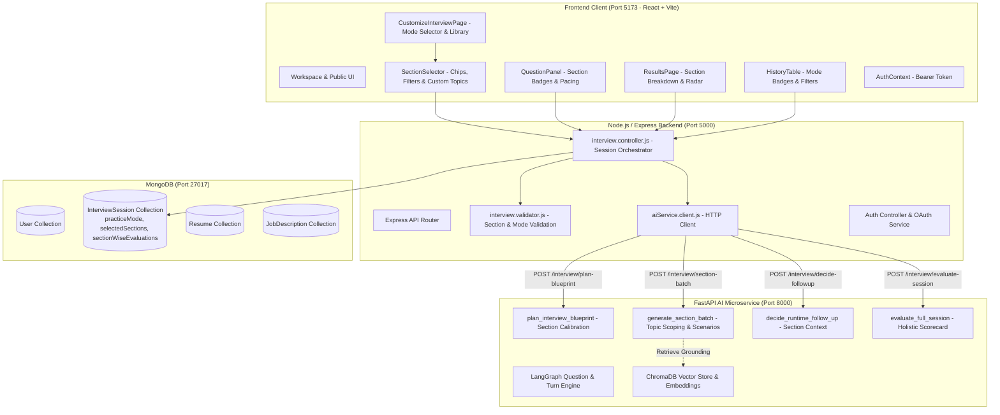
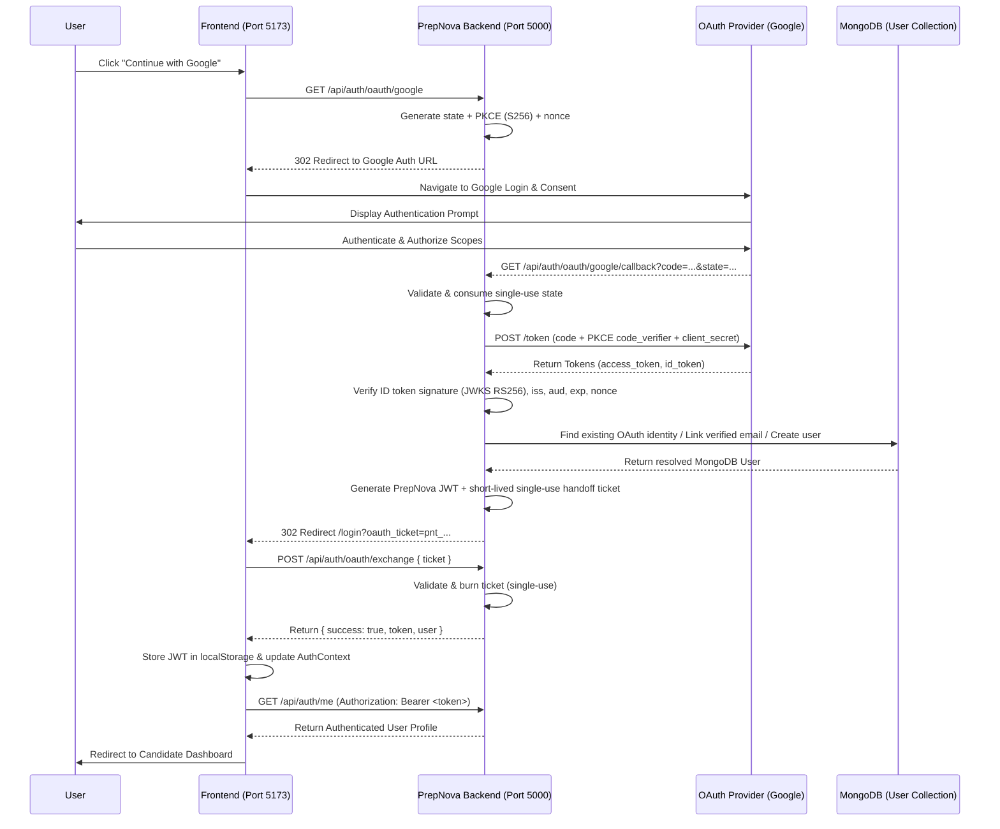

# PrepNova

PrepNova is an enterprise-grade, AI-powered mock interview simulator and technical preparation workspace featuring a Node.js/Express backend, MongoDB persistence, a Python FastAPI AI extraction & LangGraph microservice, and a responsive React frontend styled with modern SaaS design tokens.

PrepNova supports both **Complete Comprehensive Mock Interviews** (covering behavioral, project ownership, core skills, technical concepts, workplace scenarios, and HR) and **Section-Based Interview Practice** (hyper-targeted preparation across 17 curated technical categories and custom candidate-defined topics).

---

## Current Project Status

| Component | Status | Operational Port / Service | Verification |
| :--- | :--- | :--- | :--- |
| **Authentication & Authz** | **PRODUCTION-READY** | `http://localhost:5000/api/auth` | OAuth 2.0 PKCE (`S256`), OIDC Nonce, JWT, User Deletion Invalidation, Logout Revocation, Role Guards |
| **Database Persistence** | **REAL / CONNECTED** | `mongodb://127.0.0.1:27017/prepnova` | Mongoose `User`, `InterviewSession`, `Resume`, `JobDescription` models |
| **Node.js Interview Engine** | **REAL / CONNECTED** | `http://localhost:5000/api/interview` | Blueprint planning, section batch generation, runtime follow-ups, and post-session batch evaluation |
| **FastAPI AI Microservice** | **REAL / CONNECTED** | `http://127.0.0.1:8000` | LangGraph workflow, Groq LLM, ChromaDB vector store, PyMuPDF / OCR document extraction |
| **Section-Based Practice** | **PRODUCTION-READY** | `http://127.0.0.1:5173/customize` | 17-category library, custom topics, smart recommender, scenario outage generation, section-wise scorecards |
| **Frontend Web App** | **PRODUCTION-READY** | `http://127.0.0.1:5173` | Modern SaaS design system, real backend API integration, Vite production build pass (0 errors) |

---

## Current Implementation Audit

The following table documents the audited status of every feature in the PrepNova repository:

| Feature | Status | Real / Mock / Partial | Frontend Connected | Backend Connected | Database | AI Integration | Code Evidence |
| :--- | :--- | :--- | :--- | :--- | :--- | :--- | :--- |
| **User Registration** | IMPLEMENTED | REAL | Yes | Yes | MongoDB (`User`) | N/A | `backend/src/controllers/auth.controller.js`, `models/User.js` |
| **Password Hashing** | IMPLEMENTED | REAL (bcrypt 10 rounds) | Yes | Yes | MongoDB (`password` hash) | N/A | `backend/src/services/auth.service.js` |
| **User Login & JWT** | IMPLEMENTED | REAL (HS256 signed JWT) | Yes | Yes | MongoDB (`User.findOne`) | N/A | `backend/src/utils/jwt.js`, `controllers/auth.controller.js` |
| **Auth Middleware** | IMPLEMENTED | REAL | Yes | Yes | Scoped to active DB user | N/A | `backend/src/middleware/auth.middleware.js` |
| **Role Authorization** | IMPLEMENTED | REAL | Yes | Yes | Role check on user record | N/A | `backend/src/middleware/authorize.middleware.js` |
| **Password Reset (OTP)**| IMPLEMENTED | REAL (Crypto OTP + Email) | Yes | Yes | MongoDB (SHA-256 hash) | N/A | `backend/src/controllers/auth.controller.js`, `services/email.service.js` |
| **Google OAuth 2.0 / OIDC**| IMPLEMENTED | REAL (PKCE + Nonce) | Yes | Yes | MongoDB (`authProviders`) | N/A | `backend/src/oauth/*`, `controllers/oauth.controller.js` |
| **Section-Based Practice**| IMPLEMENTED | REAL | Yes | Yes | MongoDB (`InterviewSession`) | LangGraph + Section Batches | `frontend/src/components/interview/setup/SectionSelector.jsx`, `backend/src/controllers/interview.controller.js` |
| **Categorized Library** | IMPLEMENTED | REAL (17 Topics) | Yes | Yes | Section library schemas | Context retrieval query map | `frontend/src/constants/sections.js`, `AIService/app/services/interview/graph.py` |
| **Custom Section Topics**| IMPLEMENTED | REAL | Yes | Yes | MongoDB (`selectedSections`) | Dynamic LLM topic generation | `frontend/src/components/interview/setup/SectionSelector.jsx`, `AIService/app/services/interview/graph.py` |
| **Section Recommender** | IMPLEMENTED | REAL | Yes | Client Engine | Analyzes Role, Resume & JD | Deterministic skill matching | `frontend/src/lib/sectionRecommender.js` |
| **AI Question Generation**| IMPLEMENTED | REAL | Yes | Yes | MongoDB (`InterviewSession`) | LangGraph batch engine | `backend/src/services/aiService.client.js`, `AIService/app/services/interview/graph.py` |
| **Workplace Scenarios** | IMPLEMENTED | REAL | Yes | Yes | MongoDB (`questions`) | Production incident prompts | `AIService/app/services/interview/graph.py` |
| **Section-Wise Evaluation**| IMPLEMENTED| REAL | Yes | Yes | MongoDB (`finalReport`) | Batch LLM + fallback rubrics | `backend/src/controllers/interview.controller.js`, `frontend/src/pages/ResultsPage.jsx` |
| **Candidate Dashboard** | IMPLEMENTED | REAL | Yes | Yes | Auth Profile & Real Sessions | N/A | `frontend/src/pages/Dashboard.jsx` |
| **Scorecard Reports** | IMPLEMENTED | REAL | Yes | Yes | MongoDB (`InterviewSession`) | 5-dimension rubric breakdown | `frontend/src/pages/ResultsPage.jsx` |
| **History & Mode Filter**| IMPLEMENTED | REAL | Yes | Yes | MongoDB (`InterviewSession`) | Mode-aware history | `frontend/src/pages/History.jsx`, `frontend/src/components/history/HistoryTable.jsx` |
| **FastAPI Resume Extract**| IMPLEMENTED | REAL | Yes | Yes | MongoDB (`Resume`) | LangChain + ChatGroq + PyMuPDF | `AIService/app/api/routes/resume.py`, `backend/src/services/aiService.client.js` |
| **FastAPI JD Extract** | IMPLEMENTED | REAL | Yes | Yes | MongoDB (`JobDescription`) | LangChain + ChatGroq + Pydantic | `AIService/app/api/routes/jd.py`, `backend/src/services/aiService.client.js` |
| **RAG / Vector Store** | IMPLEMENTED | REAL | Yes | Yes | ChromaDB Vector Store | Sentence-Transformers | `AIService/app/services/vectorstore/chroma_store.py` |

---

## Section-Based Interview Practice

PrepNova's Section-Based Interview Practice allows candidates to prepare for specific technical topics and realistic workplace challenges without running through a full 7-section interview.



### Key Capabilities

1. **Dual Practice Modes**:
   - **Complete Interview**: Standard comprehensive flow covering introduction, projects, skills, technical fundamentals, scenarios, and behavioral questions.
   - **Selected Sections**: Focuses exclusively on topics chosen by the candidate, perfectly calibrated for targeted cramming or pre-interview skill sharpening.

2. **Large Categorized Section Library (17 Technical Categories)**:
   - General Interview & HR
   - Scenario-Based Questions (production outages, cascading failures, scaling crises)
   - Programming Fundamentals & OOP
   - Data Structures & Algorithms (DSA)
   - JavaScript (event loop, closures, V8 internals)
   - React.js & Frontend (virtual DOM, reconciliation, state management)
   - Node.js & Backend (libuv, streams, clustering, backpressure)
   - Full Stack Development (end-to-end architecture, caching tiers, auth)
   - DBMS & SQL (ACID, indexing, isolation levels, sharding)
   - Operating Systems (processes, threads, paging, IPC)
   - Computer Networks (TCP/IP, TLS 1.3, HTTP/2 & HTTP/3, DNS)
   - System Design & Architecture (distributed systems, Kafka, rate limiting)
   - AI, ML, LLM & RAG (embeddings, chunking, retrieval evaluation)
   - Cloud & DevOps (Docker, Kubernetes, Terraform IaC, CI/CD)
   - Cybersecurity (OWASP Top 10, XSS, CSRF, zero-trust)
   - Software Engineering & Testing (TDD, test doubles, Testcontainers)
   - Java & Spring Boot (JVM memory, IoC, Spring Security, Hibernate)
   - PHP & Laravel (service container, Eloquent ORM, queues)

3. **Multi-Selection & Custom Topics**:
   - Multi-select with removable active chips.
   - Instant search and category filter pills.
   - Select All / Clear All convenience actions.
   - Dynamic custom section creation: users can type any arbitrary topic (e.g. "GraphQL Performance", "Solana Smart Contracts") with full AI question generation support.

4. **Intelligent Recommendations Engine**:
   - Analyzes target role, parsed resume skills, and job description requirements.
   - Suggests top relevant sections with a 1-click "Apply Recommendations" option without restricting the user's manual selection.

5. **Realistic Workplace & Outage Scenarios**:
   - When **Scenario-Based Questions** is selected, questions are dynamically framed around real-world production outages, cascading failures, high-concurrency race conditions, and database deadlocks.

6. **Section-Wise Scorecard Breakdown**:
   - Results page renders a dedicated **Section-by-Section Performance Breakdown** panel.
   - For every section practiced: section score, progress bar, category rubrics (correctness, clarity, depth, relevance, completeness), strengths, weaknesses, and targeted improvement suggestions.

7. **Mode-Aware Interview History**:
   - Displays clear badges identifying "Complete Interview" vs "Selected Sections" (with topic chips).
   - Includes dropdown filtering by practice mode ("All Modes", "Complete Interview", "Selected Sections").

---

## System Architecture



---

## OAuth / OpenID Connect Authentication

### Overview
PrepNova features a complete, enterprise-grade, production-ready OAuth 2.0 and OpenID Connect (OIDC) authentication architecture. It supports Google Sign-In with mandatory **PKCE (`S256`)**, cryptographically secure single-use **State** validation, and OIDC **Nonce** verification against Google's public JWKS certificates (`RS256`).

### Authentication Flow Diagram



---

## Complete API Documentation

### 1. Authentication Endpoints (`/api/auth`)

| Method | Endpoint | Auth | Purpose | Response |
| :--- | :--- | :--- | :--- | :--- |
| `POST` | `/api/auth/register` | None (Rate Limited) | Create user account & hash password | `201 Created` (`token`, sanitized `user`) |
| `POST` | `/api/auth/login` | None (Rate Limited) | Validate credentials & issue JWT | `200 OK` (`token`, sanitized `user`) |
| `GET` | `/api/auth/me` | Bearer JWT | Fetch current authenticated profile | `200 OK` (sanitized `user`) |
| `POST` | `/api/auth/logout` | Bearer JWT | Invalidate & blacklist active token | `200 OK` (`message`) |
| `POST` | `/api/auth/forgot-password` | None (Rate Limited) | Generate & dispatch 6-digit OTP email | `200 OK` (Enumeration protected) |
| `POST` | `/api/auth/verify-reset-otp` | None | Verify OTP and issue signed `resetToken` | `200 OK` (`resetToken`) |
| `POST` | `/api/auth/reset-password` | None | Reset password & bump `tokenVersion` | `200 OK` (`message`) |

### 2. Interview Simulation & Practice Endpoints (`/api/interview`)

| Method | Endpoint | Auth | Purpose | Request Body / Params |
| :--- | :--- | :--- | :--- | :--- |
| `POST` | `/api/interview/start` | Bearer JWT | Initialize interview session (Complete or Selected Sections) | `{ role, level, mode, practiceMode, selectedSections, maxQuestions, resumeId, jdId }` |
| `POST` | `/api/interview/followup` | Bearer JWT | Submit candidate answer; advance section batch | `{ sessionId, answer, audioUsed }` |
| `POST` | `/api/interview/skip` | Bearer JWT | Skip question and advance to next turn | `{ sessionId }` |
| `GET` | `/api/interview/:sessionId/active` | Bearer JWT | Fetch live session state, section metadata & progress | Session ID param |
| `GET` | `/api/interview/:sessionId/report` | Bearer JWT | Fetch complete scorecard & section-wise evaluation | Session ID param |
| `POST` | `/api/interview/:sessionId/retry-evaluation` | Bearer JWT | Re-run batch evaluation if prior attempt timed out | Session ID param |
| `GET` | `/api/interview/history` | Bearer JWT | Query paginated interview history with mode filter | Query params: `page`, `limit`, `practiceMode`, `status` |
| `GET` | `/api/interview/:sessionId/pdf` | Bearer JWT | Download printable HTML/PDF interview evaluation report | Session ID param |

### 3. AI Engine Microservice Endpoints (Port 8000)

| Method | Endpoint | Purpose | Description |
| :--- | :--- | :--- | :--- |
| `POST` | `/interview/plan-blueprint` | Structured Blueprint Planning | Plans per-section question budgets across standard or selected sections |
| `POST` | `/interview/section-batch` | Section Question Generation | Generates ordered primary questions for active section with scenario & custom topic scoping |
| `POST` | `/interview/decide-followup` | Runtime Follow-Up Decisions | Evaluates answer; decides `FOLLOW_UP`, `NEXT_PRIMARY`, or `NEXT_SECTION` |
| `POST` | `/interview/evaluate-session` | Post-Interview Batch Scoring | Evaluates full transcript across 5-part rubric and produces section-wise summaries |
| `POST` | `/interview/validate-context` | 6-Dimension Fit Validation | Calibrates candidate profile against role and JD requirements |

---

## Setup & Running Locally

### 1. Prerequisites
- **Node.js**: v18.0.0+ (v20+ or v24 recommended)
- **MongoDB**: Community server running locally on `localhost:27017`
- **Python**: 3.10+ (for running FastAPI AI microservice)

### 2. Backend Setup
```bash
cd backend
npm install
cp .env.example .env
npm run dev
```
Backend runs at: **`http://localhost:5000`**

### 3. Frontend Setup
```bash
cd frontend
npm install
npm run dev
```
Frontend runs at: **`http://127.0.0.1:5173`**

### 4. AI Microservice Setup
```bash
cd AIService
python -m venv .venv
# Windows: .venv\Scripts\activate | Unix: source .venv/bin/activate
pip install -r requirements.txt
uvicorn main:app --reload --port 8000
```
AI Microservice runs at: **`http://127.0.0.1:8000`**

---

## Automated Testing Suite

To run all backend unit and contract tests:
```bash
cd backend
npm test
```

### Test Coverage Results:
- Registration Validation & Creation: **5 PASS**
- Login Authentication & Security: **4 PASS**
- JWT Generation, Signature, Expiry & Revocation: **8 PASS**
- Protected Routes & User Isolation: **3 PASS**
- Authorization & Role Guards: **3 PASS**
- Auth Input Validators: **8 PASS**
- Logout Verification & Token Revocation: **2 PASS**
- User Deletion Immediate 401 & Account Deactivation: **2 PASS**
- OAuth State, PKCE & Nonce Management: **7 PASS**
- Google OAuth & OIDC Provider RS256 Verification: **5 PASS**
- OAuth Identity Mapper & Normalizer: **4 PASS**
- OAuth & OIDC Integration: **13 PASS**
- Password Reset & OTP Lifecycle: **16 PASS**
- Email Service & Template Rendering: **4 PASS**
- Section-Wise Batch Generation & Persistence: **4 PASS**
- Interview Generation Contracts & Section Validators: **13 PASS**
- **Total: 101 tests, 26 suites, 0 failures, 100% passing.**

---

## Implementation Log

### 2026-11-15 — Phase 5: Section-Based Interview Practice & Granular Scorecard Breakdown
- **Status**: Completed & Verified (**101 passing tests across 26 suites**, Vite build pass 0 errors)
- **Changes**:
  - Implemented dual interview mode toggle (`complete` vs `selected_sections`) in `CustomizeInterviewPage.jsx`.
  - Built comprehensive 17-category searchable section library (`sections.js`) covering DSA, System Design, Scenario-Based Outages, React, Node.js, Cloud/DevOps, AI/ML/RAG, Databases, OS, Networks, Cybersecurity, and more.
  - Developed `SectionSelector.jsx` with category filter pills, instant search, removable active chips, and custom topic addition.
  - Implemented `sectionRecommender.js` to recommend top technical sections based on role, resume skills, and JD criteria with 1-click application.
  - Updated `interview.validator.js` with `validateSelectedSections` and `validatePracticeMode`.
  - Connected `aiService.client.js` to `AIService` endpoints (`/plan-blueprint`, `/section-batch`, `/decide-followup`, `/evaluate-session`).
  - Enhanced `plan_interview_blueprint` in `AIService/app/services/interview/graph.py` to plan blueprints exclusively from user-selected sections and distribute question budgets evenly.
  - Added realistic workplace and production incident scenario prompts for `scenario_based` questions, dynamic custom topic prompts, and expanded deterministic fallback pools for all 17 categories.
  - Persisted `practiceMode`, `selectedSections`, and `sectionWiseEvaluations` on Mongoose `InterviewSession` and `FinalReport` schemas.
  - Implemented `buildSectionWiseEvaluations` in `interview.controller.js` to compute section scores, category rubrics, strengths, weaknesses, and improvement suggestions.
  - Enhanced `ResultsPage.jsx` and `InterviewResults.jsx` with a dedicated **Section-by-Section Performance Breakdown** panel.
  - Updated `History.jsx` and `HistoryTable.jsx` with practice mode badges, topic chips, and dropdown filtering.

### 2026-10-03 — Phase 4: Production-Grade Forgot Password, OTP Reset & Session Revocation
- **Status**: Completed & Verified (91 passing tests)
- **Changes**:
  - Built cryptographically secure OTP generator (`crypto.randomInt`) and SHA-256 hashing utility with timing-safe verification.
  - Added `passwordResetOTPHash`, `passwordResetOTPExpiresAt`, and `tokenVersion` fields to Mongoose `User` model.
  - Implemented multi-device session revocation via `tokenVersion`.
  - Developed `EmailService` and branded HTML templates for password reset, password changed alerts, and Google SSO notices.

### 2026-10-01 — Phase 3: OAuth Hardening, User Deletion Invalidation & Graceful Logout
- **Status**: Completed & Verified (69 passing tests)
- **Changes**:
  - Implemented authoritative MongoDB user checks on every protected request (`User.findById`).
  - Guaranteed user deletion immediately invalidates active JWTs with HTTP 401.
  - Implemented server-side token revocation on logout (`POST /api/auth/logout`).
  - Added `isActive` account suspension check and unique compound OAuth index.

### 2026-10-01 — Phase 1 & 2: Authentication Core & Modern SaaS UI Redesign
- **Status**: Completed & Verified (37 passing tests)
- **Changes**:
  - Built bcrypt authentication, JWT token signing, and role-based authorization guards.
  - Redesigned user interface using curated Slate and Indigo design tokens.
  - Created modular workspace layout, dark/light theme support, and candidate dashboards.
